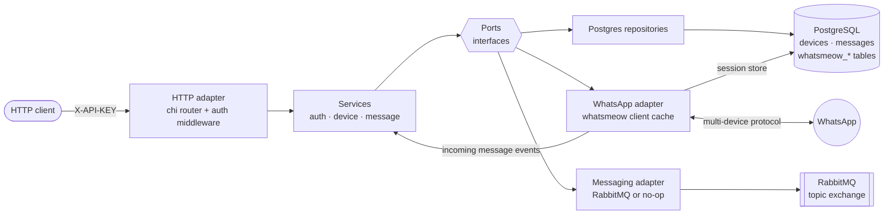
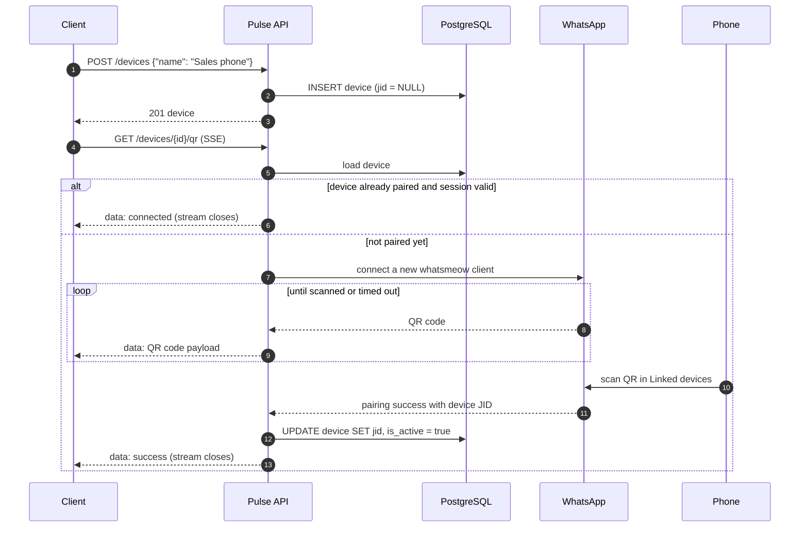
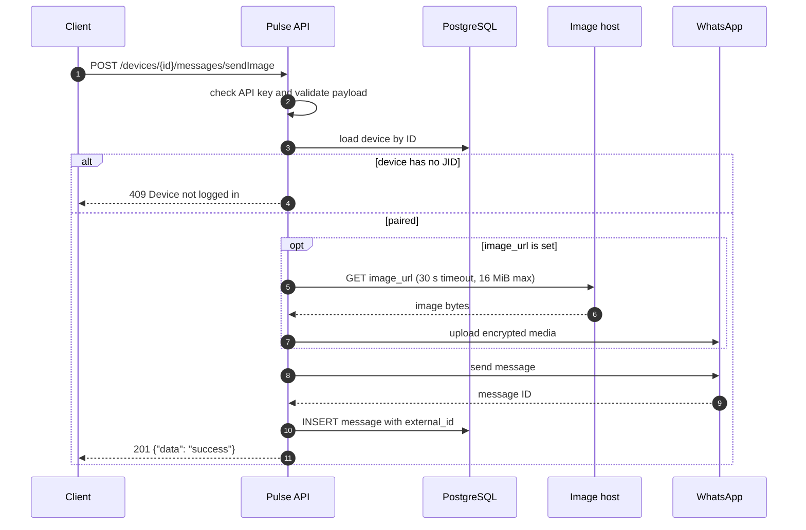
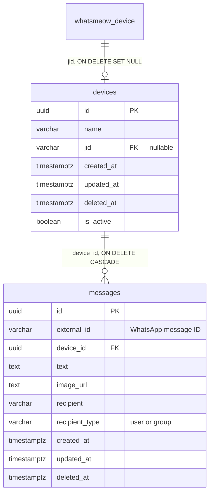

<h1 align="center">Pulse API</h1>

<p align="center">
  <strong>A self-hosted REST API for WhatsApp, written in Go.</strong><br/>
  Pair several numbers by QR code, send text and image messages over HTTP, and stream incoming messages to RabbitMQ.
</p>

<p align="center">
  <a href="https://github.com/LeonardoSola/pulse-api/actions/workflows/ci.yml"></a>
  <a href="go.mod"></a>
  <a href="LICENSE"></a>
  <a href="Dockerfile"></a>
  <a href="docker-compose.yaml"></a>
</p>

---

Pulse API is built on [whatsmeow](https://github.com/tulir/whatsmeow), a Go implementation of the WhatsApp multi-device protocol. Each **device** is a linked WhatsApp session (like WhatsApp Web) that you pair once with a QR code. Sessions are stored in PostgreSQL, and every paired device reconnects on its own when the service restarts.

> [!NOTE]
> **Status: work in progress.** Devices, pairing, sending and receiving work. The API may still change. See the [Roadmap](#roadmap).

## Table of contents

- [Features](#features)
- [Tech stack](#tech-stack)
- [Architecture](#architecture)
- [Request flows](#request-flows)
- [Quick start (Docker Compose)](#quick-start-docker-compose)
- [Running locally](#running-locally)
- [Configuration](#configuration)
- [API reference](#api-reference)
  - [Conventions](#conventions)
  - [Health](#health)
  - [Devices](#devices)
  - [Pairing (QR over SSE)](#pairing-qr-over-sse)
  - [Sending messages](#sending-messages)
  - [WAHA-compatible endpoint](#waha-compatible-endpoint)
  - [Incoming messages (RabbitMQ)](#incoming-messages-rabbitmq)
  - [Error reference](#error-reference)
- [Data model](#data-model)
- [Project structure](#project-structure)
- [Testing](#testing)
- [Deployment notes](#deployment-notes)
- [Security notes](#security-notes)
- [Troubleshooting and FAQ](#troubleshooting-and-faq)
- [Roadmap](#roadmap)
- [Disclaimer](#disclaimer)
- [License](#license)

## Features

- **Multiple devices.** Create, list, rename and delete devices. Each one is an independent WhatsApp session.
- **QR pairing over Server-Sent Events.** `GET /devices/{id}/qr` streams a new QR code each time the previous one expires, until the phone scans one.
- **Send messages.** Text, or an image with an optional caption, to a contact or a group. Recipients can be a bare number, a group ID or a full JID.
- **Receive messages.** Incoming messages are stored in PostgreSQL and, if enabled, published to a RabbitMQ topic exchange with routing key `messages.received`.
- **WAHA-compatible endpoint.** `POST /adapters/waha/api/sendText` accepts the [WAHA](https://waha.devlike.pro/) `sendText` payload, so existing WAHA clients can send text through Pulse without changes.
- **API key authentication.** One `X-API-KEY` header, compared in constant time.
- **Built for operations.** Migrations are embedded in the binary and run on startup. Logs are structured JSON (`log/slog`). Shutdown is graceful on `SIGINT`/`SIGTERM`. There is a `/health` endpoint, and the Docker image runs as a non-root user and builds natively on amd64 and arm64.
- **Hexagonal architecture.** The domain depends only on interfaces, so the WhatsApp, database and broker adapters can be replaced, and the services are unit-tested with in-memory fakes.

## Tech stack

| Concern         | Choice                                                                                      |
| --------------- | ------------------------------------------------------------------------------------------- |
| Language        | Go 1.26                                                                                     |
| WhatsApp        | [whatsmeow](https://github.com/tulir/whatsmeow) (multi-device protocol, session store)      |
| HTTP router     | [chi v5](https://github.com/go-chi/chi)                                                     |
| Database        | PostgreSQL via [pgx v5](https://github.com/jackc/pgx) (connection pool)                     |
| Migrations      | [goose v3](https://github.com/pressly/goose), SQL files embedded with `embed.FS`            |
| Messaging       | RabbitMQ via [amqp091-go](https://github.com/rabbitmq/amqp091-go) (optional)                |
| Logging         | `log/slog` JSON handler                                                                     |
| Live reload     | [air](https://github.com/air-verse/air), pinned as a Go `tool` dependency                   |
| Packaging / CI  | Multi-stage Dockerfile (Alpine), Docker Compose, GitHub Actions                             |

## Architecture

The code follows a ports-and-adapters (hexagonal) layout. The domain (`internal/`) depends only on the interfaces in `internal/ports`. HTTP, WhatsApp, PostgreSQL and RabbitMQ are adapters under `adapters/`, wired together in `adapters/bootstrap`.



- **Sending:** `HTTP -> MessageService -> WhatsApp adapter -> WhatsApp`. After WhatsApp accepts the message, it is stored with the WhatsApp message ID (`external_id`).
- **Receiving:** `WhatsApp -> event handler -> MessageService -> PostgreSQL + RabbitMQ`. With RabbitMQ disabled, a no-op publisher is used and messages are only stored.
- **Startup order** (`main.go`): config, logger, PostgreSQL pool, whatsmeow store (creates its own tables), goose migrations (they reference the whatsmeow tables), RabbitMQ, service wiring, reconnecting paired devices, then the HTTP server.

## Request flows

### Pairing a device with a QR code



### Sending a message



## Quick start (Docker Compose)

Requirements: Docker with Compose v2.20 or newer (the optional RabbitMQ dependency uses `depends_on.required`).

```bash
git clone https://github.com/LeonardoSola/pulse-api.git
cd pulse-api

cp .env.example .env
# Generate a real API key
sed -i.bak "s/^API_KEY=.*/API_KEY=$(openssl rand -hex 32)/" .env && rm .env.bak

docker compose up -d --build          # API + PostgreSQL (same as: make docker-up)

# Or with RabbitMQ (also set RABBITMQ_ENABLED=true in .env):
docker compose --profile rabbitmq up -d --build
```

Compose reads `.env`, overrides `DB_HOST=postgres` and `RABBITMQ_HOST=rabbitmq` so the API reaches the other containers by service name, and waits for PostgreSQL (and RabbitMQ, if its profile is active) to pass their health checks.

| Service     | Address                  | Notes                                                       |
| ----------- | ------------------------ | ----------------------------------------------------------- |
| API         | `http://localhost:8080`  | Port follows `SERVER_PORT`                                  |
| PostgreSQL  | `localhost:5432`         | Port follows `DB_PORT`. Data lives in the `postgres_data` volume |
| RabbitMQ    | `localhost:5672`         | Only with `--profile rabbitmq`                              |
| RabbitMQ UI | `http://localhost:15672` | Only with `--profile rabbitmq`                              |

```bash
curl http://localhost:8080/health
# {"data":{"status":"ok","uptime":"3.214567891s"}}
```

### Pair a number and send your first message

```bash
export PULSE_URL=http://localhost:8080
export PULSE_KEY=$(grep ^API_KEY .env | cut -d= -f2)

# 1. Create a device
curl -s -X POST "$PULSE_URL/devices" \
  -H "X-API-KEY: $PULSE_KEY" -H "Content-Type: application/json" \
  -d '{"name": "Sales phone"}'
# {"data":{"id":"ee24ca52-db49-439a-8b14-9e134b21d05f","jid":null,"name":"Sales phone",...,"is_active":false}}

export DEVICE_ID=ee24ca52-db49-439a-8b14-9e134b21d05f

# 2. Stream QR codes and scan one in WhatsApp > Linked devices > Link a device.
#    Each "data:" line is a QR payload. This loop renders them with qrencode:
curl -sN "$PULSE_URL/devices/$DEVICE_ID/qr" -H "X-API-KEY: $PULSE_KEY" \
  | while read -r line; do
      case "$line" in
        data:\ *) payload="${line#data: }"
                  case "$payload" in
                    success|timeout|connected|err*) echo "$payload"; break ;;
                    *) clear; qrencode -t ansiutf8 "$payload" ;;
                  esac ;;
      esac
    done

# 3. Send a message
curl -s -X POST "$PULSE_URL/devices/$DEVICE_ID/messages/sendText" \
  -H "X-API-KEY: $PULSE_KEY" -H "Content-Type: application/json" \
  -d '{"recipient": "5511999999999", "text": "Hello from Pulse API"}'
# {"data":"success"}
```

## Running locally

Requirements: Go 1.26+ and a reachable PostgreSQL instance (RabbitMQ is optional).

```bash
cp .env.example .env    # set API_KEY and the DB_* values
make run                # live reload with air, loading .env
```

To start only the database from the Compose file: `docker compose up -d postgres`.

| Command            | What it does                                          |
| ------------------ | ----------------------------------------------------- |
| `make help`        | List the available targets                            |
| `make run`         | Run with live reload (`go tool air`), loading `.env`  |
| `make build`       | Build the binary into `bin/pulse-api`                 |
| `make test`        | `go test -race ./...`                                 |
| `make vet`         | `go vet ./...`                                        |
| `make fmt`         | `gofmt -w .`                                          |
| `make docker-up`   | `docker compose up -d --build`                        |
| `make docker-down` | `docker compose down`                                 |

## Configuration

Everything is configured with environment variables. [`.env.example`](.env.example) lists all of them. The binary does not read `.env` itself: `make run` and Docker Compose load it for you.

| Variable               | Required | Default       | Description                                                                                                  |
| ---------------------- | -------- | ------------- | ------------------------------------------------------------------------------------------------------------ |
| `API_KEY`              | **yes**  |               | Key expected in the `X-API-KEY` header. Startup fails without it. Generate one with `openssl rand -hex 32`.  |
| `ENV`                  | no       | `development` | `development` (debug logs, error details in responses) or `production` (info logs, no details). Any other value fails at startup. |
| `SERVER_PORT`          | no       | `8080`        | HTTP port. An empty or non-numeric value falls back to `8080`.                                               |
| `DB_HOST`              | yes\*    |               | PostgreSQL host. Docker Compose overrides it with `postgres`.                                                |
| `DB_PORT`              | yes\*    |               | PostgreSQL port. Compose also uses it as the published host port (default `5432`).                          |
| `DB_USER`              | yes\*    |               | PostgreSQL user. Compose also uses it to create the database user.                                          |
| `DB_PASS`              | yes\*    |               | PostgreSQL password. Compose also uses it to initialize the database.                                       |
| `DB_NAME`              | yes\*    |               | Database name.                                                                                               |
| `DB_SSL_MODE`          | yes\*    |               | libpq `sslmode`, for example `disable`, `require` or `verify-full`.                                         |
| `DB_CONNECTION_STRING` | no       |               | Full connection string (URL or key/value). If set, all `DB_*` variables above are ignored.                  |
| `RABBITMQ_ENABLED`     | no       | `false`       | `true` (case-insensitive) publishes incoming messages to RabbitMQ. Startup then fails if the broker is unreachable. |
| `RABBITMQ_HOST`        | no       | `localhost`   | Broker host. Docker Compose overrides it with `rabbitmq`.                                                    |
| `RABBITMQ_PORT`        | no       | `5672`        | Broker port.                                                                                                 |
| `RABBITMQ_USER`        | no       | `guest`       | Broker user (URL-escaped automatically).                                                                     |
| `RABBITMQ_PASSWORD`    | no       | `guest`       | Broker password (URL-escaped automatically).                                                                 |
| `RABBITMQ_VHOST`       | no       | `/`           | Virtual host (URL-escaped automatically).                                                                    |
| `RABBITMQ_EXCHANGE`    | no       | `pulse-api`   | Durable topic exchange, declared on startup.                                                                 |
| `RABBITMQ_URL`         | no       |               | Full AMQP URL. If set, it replaces `RABBITMQ_HOST`, `_PORT`, `_USER`, `_PASSWORD` and `_VHOST`.              |

\* Not needed when `DB_CONNECTION_STRING` is set.

## API reference

A ready-to-import Postman collection is available in [`Pulse API.postman_collection.json`](Pulse%20API.postman_collection.json).

| Method   | Path                               | Auth | Success | Description                                      |
| -------- | ---------------------------------- | ---- | ------- | ------------------------------------------------ |
| `GET`    | `/health`                          | no   | `200`   | Liveness check and uptime                        |
| `GET`    | `/devices`                         | yes  | `200`   | List devices                                     |
| `POST`   | `/devices`                         | yes  | `201`   | Create a device                                  |
| `GET`    | `/devices/{id}`                    | yes  | `200`   | Get a device                                     |
| `PUT`    | `/devices/{id}`                    | yes  | `200`   | Rename a device                                  |
| `DELETE` | `/devices/{id}`                    | yes  | `200`   | Delete a device and unlink its WhatsApp session  |
| `GET`    | `/devices/{id}/qr`                 | yes  | `200`   | Pair the device (Server-Sent Events)             |
| `POST`   | `/devices/{id}/messages/sendText`  | yes  | `201`   | Send a text message                              |
| `POST`   | `/devices/{id}/messages/sendImage` | yes  | `201`   | Send an image with an optional caption           |
| `POST`   | `/adapters/waha/api/sendText`      | yes  | `200`   | WAHA-compatible text message                     |

### Conventions

- **Authentication:** every endpoint except `GET /health` needs `X-API-KEY: <API_KEY>`. A missing or wrong key returns `401`.
- **Bodies** are JSON. Send `Content-Type: application/json`. A body that is not valid JSON returns `400 Invalid body`.
- **Device IDs** are UUIDs. An ID that is not a valid UUID returns `404`, the same as an unknown ID.
- **Success** responses are wrapped in `data`. Actions with no resource to return (update, delete, send) return the string `"success"`:

  ```json
  { "data": "success" }
  ```

- **Errors** always have this shape:

  ```json
  { "message": "Device not found", "status": 404, "level": 0 }
  ```

  With `ENV=development`, errors that wrap an underlying cause also include `info` (the cause) and `level` (its log level). Unexpected errors are returned as `500 Internal server error`, and their details are only shown in development.

### Health

`GET /health`, no authentication. `uptime` is a Go duration string.

```bash
curl -s "$PULSE_URL/health"
```

```json
{ "data": { "status": "ok", "uptime": "1h2m3.456789s" } }
```

### Devices

A device:

```json
{
  "id": "ee24ca52-db49-439a-8b14-9e134b21d05f",
  "jid": "5511999999999:12@s.whatsapp.net",
  "name": "Sales phone",
  "created_at": "2026-11-18T14:09:59.70783-03:00",
  "updated_at": "2026-11-18T14:12:31.10422-03:00",
  "is_active": true
}
```

| Field                      | Description                                                                                       |
| -------------------------- | ------------------------------------------------------------------------------------------------- |
| `id`                       | UUID generated by the API.                                                                        |
| `jid`                      | WhatsApp JID of the linked session, or `null` until paired.                                       |
| `name`                     | Free-form label, 3 to 255 bytes.                                                                  |
| `is_active`                | Set to `true` when pairing completes. It is not a live connection status (see the [FAQ](#troubleshooting-and-faq)). |
| `created_at`, `updated_at` | RFC 3339 timestamps.                                                                              |

#### `GET /devices`

Returns every device as an array (`[]` when there are none).

```bash
curl -s "$PULSE_URL/devices" -H "X-API-KEY: $PULSE_KEY"
```

```json
{ "data": [ { "id": "ee24ca52-...", "jid": null, "name": "Sales phone", "...": "..." } ] }
```

#### `POST /devices`

| Field  | Type   | Required | Rules          |
| ------ | ------ | -------- | -------------- |
| `name` | string | yes      | 3 to 255 bytes |

```bash
curl -s -X POST "$PULSE_URL/devices" -H "X-API-KEY: $PULSE_KEY" \
  -H "Content-Type: application/json" -d '{"name": "Sales phone"}'
```

Returns `201` with the new device (`jid: null`, `is_active: false`), or `400` if the name is too short or too long:

```json
{ "message": "Device invalid name, must be between 3 and 255 characters", "status": 400, "level": 0 }
```

#### `GET /devices/{id}`

```bash
curl -s "$PULSE_URL/devices/$DEVICE_ID" -H "X-API-KEY: $PULSE_KEY"
```

Returns `200` with the device, or `404 Device not found`.

#### `PUT /devices/{id}`

Renames the device. `name` is optional: if it is omitted, nothing changes and the request still succeeds.

```bash
curl -s -X PUT "$PULSE_URL/devices/$DEVICE_ID" -H "X-API-KEY: $PULSE_KEY" \
  -H "Content-Type: application/json" -d '{"name": "Support phone"}'
```

Returns `200 {"data":"success"}`, `400` for an invalid name, or `404` for an unknown device.

#### `DELETE /devices/{id}`

Deletes the device and its stored messages. If the device was paired, Pulse also logs the session out of WhatsApp, so it disappears from the phone's linked devices. If logout fails, it deletes the local session instead.

```bash
curl -s -X DELETE "$PULSE_URL/devices/$DEVICE_ID" -H "X-API-KEY: $PULSE_KEY"
```

Returns `200 {"data":"success"}` or `404`.

### Pairing (QR over SSE)

`GET /devices/{id}/qr` returns a `text/event-stream`. Use a client that does not buffer the response, such as `curl -N`. Browsers' `EventSource` cannot set the `X-API-KEY` header, so call it from a backend or use a fetch-based SSE client.

```bash
curl -N "$PULSE_URL/devices/$DEVICE_ID/qr" -H "X-API-KEY: $PULSE_KEY"
```

```text
data: 2@Vf3k...,Xq1...,Zp9...,AbC...

data: 2@Hk2m...,Xq1...,Zp9...,AbC...

data: success

```

Each event is a single `data:` line, with no `event:` name or ID.

| `data` value                        | Meaning                                                                                 | Stream     |
| ----------------------------------- | --------------------------------------------------------------------------------------- | ---------- |
| QR code payload                     | Render it as a QR code and scan it. A new one arrives as each code expires.             | stays open |
| `success`                           | Pairing finished. The device JID is saved right after this event.                       | closes     |
| `connected`                         | The device was already paired and its session is still valid. Nothing to do.            | closes     |
| `timeout`                           | No code was scanned before WhatsApp stopped issuing codes. Call the endpoint again.     | closes     |
| `err-client-outdated`, `err-unexpected-state`, `err-scanned-without-multidevice`, `error`, ... | Pairing failed. The value is whatsmeow's QR channel event name. | closes |

Errors that happen before the stream starts (`401`, `404`) are normal JSON error responses. If the client disconnects early, pairing is cancelled. Calling the endpoint for a device whose session is no longer valid starts a new pairing, and the new JID replaces the old one.

### Sending messages

`POST /devices/{id}/messages/sendText` and `POST /devices/{id}/messages/sendImage` take the same body:

| Field            | Type   | Required             | Description                                                                                                          |
| ---------------- | ------ | -------------------- | -------------------------------------------------------------------------------------------------------------------- |
| `recipient`      | string | yes                  | Phone number in international format without `+` (`5511999999999`), a group ID (`120363000000000000`), or a full JID (`5511999999999@s.whatsapp.net`, `...@c.us`, `...@g.us`). |
| `recipient_type` | string | no                   | `user` (default) or `group`. Ignored when `recipient` is a full JID: `@g.us` means group, any other server means user. |
| `text`           | string | yes, unless an image | Message text, or the image caption.                                                                                 |
| `image_url`      | string | yes, for `sendImage` | `http(s)` URL of the image. The server downloads it and uploads it to WhatsApp.                                      |

The device must be paired first, otherwise the API returns `409 Device not logged in`. On success, both endpoints return `201 {"data":"success"}`. The WhatsApp message ID is stored in the database but not returned.

```bash
# Text to a contact
curl -s -X POST "$PULSE_URL/devices/$DEVICE_ID/messages/sendText" \
  -H "X-API-KEY: $PULSE_KEY" -H "Content-Type: application/json" \
  -d '{"recipient": "5511999999999", "text": "Hello from Pulse API"}'

# Text to a group, bare ID + type
curl -s -X POST "$PULSE_URL/devices/$DEVICE_ID/messages/sendText" \
  -H "X-API-KEY: $PULSE_KEY" -H "Content-Type: application/json" \
  -d '{"recipient": "120363000000000000", "recipient_type": "group", "text": "Hi team"}'

# Text to a group, full JID
curl -s -X POST "$PULSE_URL/devices/$DEVICE_ID/messages/sendText" \
  -H "X-API-KEY: $PULSE_KEY" -H "Content-Type: application/json" \
  -d '{"recipient": "120363000000000000@g.us", "text": "Hi team"}'

# Image with caption
curl -s -X POST "$PULSE_URL/devices/$DEVICE_ID/messages/sendImage" \
  -H "X-API-KEY: $PULSE_KEY" -H "Content-Type: application/json" \
  -d '{"recipient": "5511999999999", "text": "Our new menu", "image_url": "https://example.com/menu.png"}'
```

**How images are fetched:** a `GET` with a 30-second timeout. The response must be `200` and at most 16 MiB (WhatsApp's image limit). The MIME type comes from the `Content-Type` header, then content sniffing, then the URL extension (`.jpg`, `.jpeg`, `.png`, `.gif`, `.webp`). The first `image/*` match wins.

> [!TIP]
> Both endpoints share one code path. If you send `image_url` to `sendText`, the message goes out as an image. `sendImage` only adds the check that `image_url` is present.

| Status | When                                                                                                                 |
| ------ | -------------------------------------------------------------------------------------------------------------------- |
| `201`  | WhatsApp accepted the message and it was stored.                                                                     |
| `400`  | `Invalid body`, `Invalid recipient`, `Invalid recipient type`, `Message must have text or an image`, or `image_url is required` (`sendImage` only). |
| `401`  | Missing or wrong API key.                                                                                            |
| `404`  | Unknown device, or the ID is not a UUID.                                                                             |
| `409`  | `Device not logged in`: the device was never paired, or its session was removed.                                     |
| `422`  | `Could not download image from image_url`: the download failed or timed out, the file was too large, or it was not an image. |
| `500`  | WhatsApp rejected the message, the connection failed, or the database write failed.                                  |

### WAHA-compatible endpoint

`POST /adapters/waha/api/sendText` accepts the WAHA `sendText` payload. Code written for WAHA can send text through Pulse by changing only the base URL and the auth header.

| WAHA field | Pulse meaning                                                    |
| ---------- | ---------------------------------------------------------------- |
| `session`  | The Pulse device ID (UUID).                                      |
| `chatId`   | A full JID. Must contain `@` (`5511999999999@c.us`, `...@g.us`). |
| `text`     | Message text (required).                                         |

```bash
curl -s -X POST "$PULSE_URL/adapters/waha/api/sendText" \
  -H "X-API-KEY: $PULSE_KEY" -H "Content-Type: application/json" \
  -d "{\"session\": \"$DEVICE_ID\", \"chatId\": \"5511999999999@c.us\", \"text\": \"Hello\"}"
```

Returns `200 {"data":"success"}`. Error codes are the same as for `sendText`.

### Incoming messages (RabbitMQ)

With `RABBITMQ_ENABLED=true`, every message received by a paired device is stored and then published to the `RABBITMQ_EXCHANGE` topic exchange:

| Property      | Value                                                            |
| ------------- | ---------------------------------------------------------------- |
| Exchange      | `RABBITMQ_EXCHANGE` (default `pulse-api`), type `topic`, durable |
| Routing key   | `messages.received`                                              |
| Content type  | `application/json`                                               |
| Delivery mode | persistent                                                       |

Pulse only declares the exchange. To consume messages, declare a queue and bind it to the routing key, for example with `rabbitmqadmin` from the management image:

```bash
docker exec pulse-api-rabbitmq rabbitmqadmin declare queue name=whatsapp-inbox durable=true
docker exec pulse-api-rabbitmq rabbitmqadmin declare binding \
  source=pulse-api destination=whatsapp-inbox routing_key=messages.received
```

Payload:

```json
{
  "id": "4d1c7c1e-0f5b-4a3e-9d55-1f0a3c2b9e10",
  "external_id": "3EB0C431C26A1916E07A",
  "device_id": "ee24ca52-db49-439a-8b14-9e134b21d05f",
  "text": "Hi! Is the store open today?",
  "image_url": "",
  "from": "5511988888888@s.whatsapp.net",
  "recipient": "5511988888888",
  "recipient_type": "user",
  "created_at": "2026-11-18T14:20:31-03:00",
  "updated_at": "2026-11-18T14:20:33.512-03:00",
  "deleted_at": null
}
```

| Field                         | Description                                                                                                   |
| ----------------------------- | ------------------------------------------------------------------------------------------------------------- |
| `id`                          | UUID generated by Pulse for the stored message.                                                               |
| `external_id`                 | WhatsApp message ID.                                                                                          |
| `device_id`                   | Pulse device that received the message.                                                                       |
| `text`                        | Plain text, the text of a reply or link preview, or the caption of an image, video or document. Empty for other message types. |
| `image_url`                   | Always empty for incoming messages. Media is not downloaded yet.                                              |
| `from`                        | Sender JID, without the device suffix. In groups, this is the member who wrote the message.                   |
| `recipient`, `recipient_type` | The chat the message arrived in: the contact's number (`user`) or the group ID (`group`).                     |
| `created_at`                  | WhatsApp's message timestamp.                                                                                 |
| `updated_at`                  | When Pulse processed the message.                                                                             |

Notes:

- Every whatsmeow `events.Message` is forwarded. That includes messages sent from the phone itself, and message types without text (stickers, reactions and so on, with an empty `text`). Filter on the consumer side if needed.
- With RabbitMQ disabled, incoming messages are still stored in the `messages` table.
- Publishing is best effort. If a publish fails, the error is logged, the message stays in PostgreSQL, and there is no retry.

### Error reference

| Status | `message`                                                   | Cause                                     |
| ------ | ----------------------------------------------------------- | ----------------------------------------- |
| `400`  | `Invalid body`                                              | Body is not valid JSON                    |
| `400`  | `Device invalid name, must be between 3 and 255 characters` | Creating or renaming a device             |
| `400`  | `Invalid recipient`                                         | Empty or malformed recipient or JID       |
| `400`  | `Invalid recipient type`                                    | `recipient_type` is not `user` or `group` |
| `400`  | `Message must have text or an image`                        | Both `text` and `image_url` are empty     |
| `400`  | `image_url is required`                                     | `sendImage` without `image_url`           |
| `401`  | `Unauthorized`                                              | Missing or wrong `X-API-KEY`              |
| `404`  | `Device not found`                                          | Unknown ID, or the ID is not a UUID       |
| `409`  | `Device not logged in`                                      | Sending from an unpaired device           |
| `422`  | `Could not download image from image_url`                   | Image fetch or MIME check failed          |
| `500`  | `Internal server error` or `Error selecting device`         | Unexpected database or WhatsApp error     |

## Data model

Migrations live in [`migrations/`](migrations) and are embedded in the binary. goose applies them on startup and tracks them in the `schema_migrations` table. whatsmeow creates and upgrades its own `whatsmeow_*` tables in the same database.



Outgoing and incoming messages both go into `messages`. Message text is stored as plain text.

## Project structure

```text
pulse-api/
├── main.go                       # Startup order, HTTP server, graceful shutdown
├── adapters/
│   ├── bootstrap/                # Wires services to their adapters
│   ├── cmd/
│   │   ├── http/                 # chi router, API key middleware, JSON/SSE helpers
│   │   │   └── handlers/         # app (health), devices, messages, adapters/waha
│   │   └── whatsapp/             # whatsmeow store, client cache, pairing, text/image sending
│   │       └── events/           # Incoming event handler and message text extraction
│   ├── database/postgres/        # pgx pool, goose runner, device and message repositories
│   └── messaging/
│       ├── rabbitmq/             # Topic exchange publisher
│       └── dummy/                # No-op publisher used when RabbitMQ is disabled
├── internal/
│   ├── config/                   # Environment configuration
│   ├── custom_error/             # Typed errors carrying an HTTP status and log level
│   ├── entities/                 # Device and Message models and validation
│   ├── logger/                   # slog JSON logger
│   ├── ports/                    # Interfaces the adapters implement
│   └── services/                 # auth, device and message use cases
├── migrations/                   # SQL migrations (embed.FS)
├── .github/workflows/ci.yml      # gofmt, build, vet, race tests, Docker build
├── Dockerfile                    # Multi-stage build, static binary, non-root Alpine runtime
├── docker-compose.yaml           # API + PostgreSQL 16 (+ RabbitMQ 3.13 profile)
├── Makefile
└── Pulse API.postman_collection.json
```

## Testing

```bash
make test                 # go test -race ./...
go test -cover ./...      # coverage per package
```

The unit tests need no database, broker or WhatsApp connection. They cover:

- **Entities:** device name rules, UUID validation, recipient parsing (bare IDs, `@s.whatsapp.net`, `@c.us`, `@g.us`, malformed JIDs) and message validation.
- **Configuration:** defaults, connection string precedence, and AMQP URL building with escaped credentials and vhosts.
- **Services:** auth (constant-time key check), plus the device and message services with in-memory fakes of the ports. This includes pairing, the already-connected shortcut, reconnecting on startup, the not-logged-in guard, and publishing incoming messages.
- **HTTP:** the API key middleware, success and error response shapes (internal errors are not leaked outside development), SSE framing, and request-to-message mapping.
- **WhatsApp adapter:** image download limits, MIME detection, and text extraction from incoming messages.

The repositories and the RabbitMQ publisher have no tests yet. They need integration tests against real services.

[CI](.github/workflows/ci.yml) runs on every push to `main` and on every pull request. It checks `gofmt`, runs `go build`, `go vet` and `go test -race -count=1`, and then builds the Docker image.

## Deployment notes

- **Image:** `docker build -t pulse-api .` produces a static, stripped binary (`CGO_ENABLED=0`, `-trimpath -s -w`) on `alpine:3.22`, running as UID `10001`. It builds natively on amd64 and arm64 hosts. The server listens on `SERVER_PORT`, and the Dockerfile `EXPOSE`s `8080`.
- **Configuration:** set `ENV=production` to hide error details and log at info level. Pass secrets as environment variables or through your orchestrator's secret store.
- **Database:** any recent PostgreSQL works. The migrations use `gen_random_uuid()`, which is built in from PostgreSQL 13. **The database holds the WhatsApp session keys.** Back it up and protect it like a credential store. If you lose it, every device has to be paired again.
- **One replica per database.** Each paired device keeps one live connection inside the process. Two instances on the same database would connect the same sessions twice. Scale vertically, or split devices across separate deployments.
- **Reverse proxy:** run the API behind a TLS-terminating proxy. For `/devices/{id}/qr`, disable response buffering (nginx: `proxy_buffering off;`) and allow long read timeouts. The server sets no write timeout so that SSE streams can stay open.
- **Health checks:** `GET /health` needs no auth. It only reports that the process is up, not that WhatsApp or PostgreSQL are reachable. The Compose file checks it with `wget`.
- **Shutdown:** on `SIGINT`/`SIGTERM`, the server stops accepting requests and waits up to 10 seconds for in-flight ones. After that it force-closes connections, including open SSE streams, and disconnects the WhatsApp clients.
- **Logs:** application logs are JSON on stdout. whatsmeow's own logs (errors only) are plain text on stdout.

## Security notes

Pulse is meant to run as a private, internal service. Before exposing it, keep these points in mind:

- **One shared API key.** There are no users, scopes or per-device permissions. Anyone with the key can pair, list and delete devices and send messages from any linked number. Use a long random key, rotate it by restarting with a new value, and do not expose the API to the public internet without a gateway in front of it.
- **No rate limiting.** Nothing limits how many messages a client can send. Sending too much, too fast is the most common way to get a number banned by WhatsApp.
- **`image_url` is fetched server-side (SSRF risk).** The server sends a `GET` to any URL it receives, follows redirects, and does not block private or link-local addresses. A caller with the API key can make the server send requests to internal services, such as `http://169.254.169.254/` (cloud metadata) or other containers. The response body is never returned, but in development mode error details such as status codes appear in `info`. If untrusted parties can reach the API, restrict outbound traffic at the network level or route it through an allowlisting proxy.
- **Docker Compose publishes PostgreSQL on the host.** `docker-compose.yaml` maps `${DB_PORT:-5432}:5432`, which binds on all interfaces by default. That database holds the WhatsApp session keys. On a server, remove the `ports:` entry from the `postgres` service (the API reaches it over the internal network), bind it to `127.0.0.1`, or firewall it. Also change `DB_PASS` from `change-me`.
- **RabbitMQ defaults.** With the `rabbitmq` profile, ports `5672` and `15672` are published on the host, with `guest`/`guest` credentials unless you change `RABBITMQ_USER` and `RABBITMQ_PASSWORD`.
- **`ENV=development` exposes internal errors.** Error responses then include the underlying error text. `.env.example` ships with `development`, so switch to `production` for any shared deployment.
- **Data at rest.** Message text and session keys are stored unencrypted in PostgreSQL. Use disk or database encryption where your requirements call for it.
- **No TLS in the binary.** Terminate TLS at a proxy or load balancer.

## Troubleshooting and FAQ

<details>
<summary><strong>Startup fails with <code>API_KEY is required</code> or <code>invalid environment</code></strong></summary>

`API_KEY` must be set, and `ENV` must be exactly `development` or `production` (or unset). If you run the binary directly, it does not read `.env`. Use `make run`, or export the variables first with `set -a && source .env && set +a`.
</details>

<details>
<summary><strong><code>failed to ping database</code></strong></summary>

Check the `DB_*` values or `DB_CONNECTION_STRING`. Compose forces `DB_HOST=postgres`. When you run locally against the Compose database, use `DB_HOST=localhost`. If PostgreSQL was first initialized with other credentials, the `postgres_data` volume keeps them. `docker compose down -v` resets it, but it deletes all data, including sessions.
</details>

<details>
<summary><strong><code>failed to connect to RabbitMQ</code></strong></summary>

With `RABBITMQ_ENABLED=true`, the broker must be reachable at startup. Start Compose with `--profile rabbitmq`, or set `RABBITMQ_ENABLED=false`.
</details>

<details>
<summary><strong>The QR stream prints nothing</strong></summary>

Use `curl -N` to turn off buffering. Behind a proxy, disable response buffering for that route.
</details>

<details>
<summary><strong>The stream ends with <code>timeout</code></strong></summary>

WhatsApp issues a limited number of codes per pairing attempt. Call `GET /devices/{id}/qr` again and scan sooner.
</details>

<details>
<summary><strong>Sending returns <code>409 Device not logged in</code></strong></summary>

The device has no JID, so pair it with `GET /devices/{id}/qr`. This also happens after the session is removed from the phone (Linked devices > Log out). whatsmeow then deletes the session, and the foreign key resets the device's `jid` to `null`.
</details>

<details>
<summary><strong><code>is_active</code> is <code>true</code> but sending fails</strong></summary>

`is_active` is set when pairing completes and is not updated afterwards, so it is not a live connection indicator. Check `jid`: if it is `null`, pair again. Otherwise, the logs show the WhatsApp error.
</details>

<details>
<summary><strong>Right after <code>success</code>, the device still shows <code>jid: null</code></strong></summary>

The JID is written to the database asynchronously, right after the `success` event. Fetch the device again a moment later.
</details>

<details>
<summary><strong>Sending an image returns <code>422</code></strong></summary>

The URL must be reachable from the server (not just from your machine), return `200`, be 16 MiB or smaller, and point to an image. With `ENV=development`, the `info` field says which check failed.
</details>

<details>
<summary><strong>What number format should I use?</strong></summary>

International format, digits only, with no `+`, spaces or dashes: `5511999999999`. For groups, use the group ID with `"recipient_type": "group"`, or the full `...@g.us` JID. Group IDs appear in the `recipient` field of incoming messages.
</details>

<details>
<summary><strong>Is this the official WhatsApp Business API?</strong></summary>

No. Pulse links to a regular WhatsApp or WhatsApp Business app account as a companion device, the same way WhatsApp Web does. It does not use Meta's Cloud API.
</details>

## Roadmap

- [x] Multiple devices with QR pairing over SSE
- [x] Text and image messages to contacts and groups
- [x] Incoming messages to PostgreSQL and RabbitMQ
- [x] WAHA-compatible `sendText`
- [ ] Return the WhatsApp message ID from the send endpoints
- [ ] Message history endpoints, plus message update and delete
- [ ] More message types: video, documents, audio, stickers, location, contacts, polls
- [ ] Download incoming media
- [ ] Presence (typing) and read receipts
- [ ] Webhooks and real-time event streaming beyond RabbitMQ
- [ ] Contacts, chats and group management
- [ ] Live connection status per device
- [ ] Rate limiting and an outbound URL allowlist for `image_url`
- [ ] Integration tests for the repositories and the publisher
- [ ] Broader WAHA coverage and adapters for other WhatsApp API providers

## Disclaimer

Pulse API is an independent project. It is **not affiliated with, authorized, maintained, sponsored or endorsed by WhatsApp, Meta, or any of their affiliates**. "WhatsApp" is a trademark of its respective owner. Pulse uses an unofficial, reverse-engineered implementation of the WhatsApp multi-device protocol. Using it may violate WhatsApp's Terms of Service and can get numbers restricted or banned. Do not use it for spam or unsolicited messages. Use it responsibly and at your own risk.

## License

Released under the [MIT License](LICENSE). © 2026 Leonardo Sola.

---

<p align="center">
  Built by <strong>Leonardo Sola</strong> · Portfolio: <a href="https://sola.dev.br">sola.dev.br</a> · LinkedIn: <a href="https://www.linkedin.com/in/leonardo-sola/">leonardo-sola</a>
</p>

<p align="center">
  <a href="https://sola.dev.br"></a>
  <a href="https://www.linkedin.com/in/leonardo-sola/"></a>
</p>
