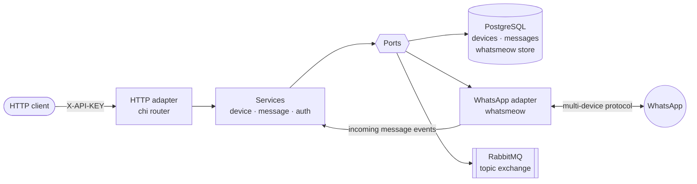

# Pulse API

[](https://github.com/LeonardoSola/pulse-api/actions/workflows/ci.yml)

[](LICENSE)

**A self-hosted REST API for WhatsApp: pair multiple numbers by QR code, send text and image messages over HTTP, and stream incoming messages to RabbitMQ.**

Pulse API is written in Go on top of [whatsmeow](https://github.com/tulir/whatsmeow), which implements the WhatsApp multi-device protocol. Each "device" is a linked WhatsApp session that you pair once. The session is stored in PostgreSQL and reconnects automatically when the service restarts.

> **Status:** work in progress. The core flows (devices, pairing, sending, receiving) work. The API surface may still change. See the [Roadmap](#roadmap).

## Features

- **Multi-device management:** create, list, rename and delete devices. Each one is an independent WhatsApp session.
- **QR pairing over Server-Sent Events:** `GET /devices/{id}/qr` streams fresh QR codes until the phone scans one.
- **Send messages:** text, or an image with an optional caption, to users or groups.
- **Incoming messages:** stored in PostgreSQL and, when enabled, published to a RabbitMQ topic exchange (`messages.received`).
- **WAHA-compatible endpoint:** `POST /adapters/waha/api/sendText` accepts the [WAHA](https://waha.devlike.pro/) payload, so existing WAHA clients can send text through Pulse.
- **API key authentication:** a single `X-API-KEY` header, checked in constant time.
- **Operations:** migrations embedded in the binary and applied on startup, structured JSON logs (`log/slog`), graceful shutdown, a `/health` endpoint, and a multi-arch Docker image that runs as a non-root user.

## Architecture

The code follows a ports-and-adapters (hexagonal) layout. The domain lives in `internal/` and depends only on interfaces (`internal/ports`). HTTP, WhatsApp, PostgreSQL and RabbitMQ are adapters under `adapters/`.



**Sending:** `HTTP → MessageService → WhatsApp adapter → WhatsApp`. The message is stored together with the WhatsApp message ID.

**Receiving:** `WhatsApp → event handler → MessageService → PostgreSQL + RabbitMQ` (routing key `messages.received`). If RabbitMQ is disabled, a no-op publisher is used.

## Quick start (Docker Compose)

Requirements: Docker with Compose v2.20 or newer.

```bash
git clone https://github.com/LeonardoSola/pulse-api.git
cd pulse-api

cp .env.example .env
# set a real API key
sed -i.bak "s/^API_KEY=.*/API_KEY=$(openssl rand -hex 32)/" .env && rm .env.bak

docker compose up -d --build          # API + PostgreSQL
# or, with RabbitMQ (also set RABBITMQ_ENABLED=true in .env):
docker compose --profile rabbitmq up -d --build
```

The API listens on `http://localhost:8080`. The RabbitMQ management UI, when enabled, is at `http://localhost:15672`.

```bash
curl http://localhost:8080/health
# {"data":{"status":"ok","uptime":"3.2s"}}
```

### Pair a WhatsApp number

```bash
export PULSE_URL=http://localhost:8080
export PULSE_KEY=$(grep ^API_KEY .env | cut -d= -f2)

# 1. Create a device
curl -s -X POST "$PULSE_URL/devices" \
  -H "X-API-KEY: $PULSE_KEY" -H "Content-Type: application/json" \
  -d '{"name": "Sales phone"}'
# {"data":{"id":"ee24ca52-...","jid":null,"name":"Sales phone","is_active":false,...}}

# 2. Stream QR codes. Render each one, for example with `qrencode -t ansiutf8`,
#    and scan it in WhatsApp > Linked devices > Link a device.
curl -N "$PULSE_URL/devices/<device-id>/qr" -H "X-API-KEY: $PULSE_KEY"
# data: <qr-code-payload>
# data: <qr-code-payload>
# data: success
```

After `success`, the device's `jid` is filled in and `is_active` becomes `true`.

## Running locally

Requirements: Go 1.26+ and a PostgreSQL instance.

```bash
cp .env.example .env    # set API_KEY and the DB_* values
make run                # live reload with air (pinned as a Go tool dependency)
```

| Command            | Description                           |
| ------------------ | ------------------------------------- |
| `make run`         | Run with live reload, loading `.env`  |
| `make build`       | Build `bin/pulse-api`                 |
| `make test`        | Run unit tests with the race detector |
| `make vet`         | Run `go vet`                          |
| `make docker-up`   | `docker compose up -d --build`        |
| `make docker-down` | `docker compose down`                 |

## Configuration

All configuration is read from environment variables. `.env.example` lists all of them.

| Variable               | Required | Default       | Description                                                                                               |
| ---------------------- | -------- | ------------- | --------------------------------------------------------------------------------------------------------- |
| `API_KEY`              | yes      |               | Key expected in the `X-API-KEY` header. Generate one with `openssl rand -hex 32`.                         |
| `ENV`                  | no       | `development` | `development` (debug logs, error details in responses) or `production`. Any other value fails at startup. |
| `SERVER_PORT`          | no       | `8080`        | HTTP port.                                                                                                |
| `DB_HOST`              | yes\*    |               | PostgreSQL host. Docker Compose sets it to `postgres`.                                                    |
| `DB_PORT`              | yes\*    |               | PostgreSQL port.                                                                                          |
| `DB_USER`              | yes\*    |               | PostgreSQL user.                                                                                          |
| `DB_PASS`              | yes\*    |               | PostgreSQL password.                                                                                      |
| `DB_NAME`              | yes\*    |               | Database name.                                                                                            |
| `DB_SSL_MODE`          | yes\*    |               | libpq `sslmode`, for example `disable` or `require`.                                                      |
| `DB_CONNECTION_STRING` | no       |               | Full connection string. If set, it replaces all `DB_*` variables above.                                   |
| `RABBITMQ_ENABLED`     | no       | `false`       | Publish incoming messages to RabbitMQ.                                                                    |
| `RABBITMQ_HOST`        | no       | `localhost`   | Broker host. Docker Compose sets it to `rabbitmq`.                                                        |
| `RABBITMQ_PORT`        | no       | `5672`        | Broker port.                                                                                              |
| `RABBITMQ_USER`        | no       | `guest`       | Broker user.                                                                                              |
| `RABBITMQ_PASSWORD`    | no       | `guest`       | Broker password.                                                                                          |
| `RABBITMQ_VHOST`       | no       | `/`           | Virtual host.                                                                                             |
| `RABBITMQ_EXCHANGE`    | no       | `pulse-api`   | Durable topic exchange, declared on startup.                                                              |
| `RABBITMQ_URL`         | no       |               | Full AMQP URL. If set, it replaces the `RABBITMQ_*` connection variables above.                           |

\* Not needed if you set `DB_CONNECTION_STRING`.

## API reference

Every endpoint except `GET /health` requires the `X-API-KEY` header. Request and response bodies are JSON.

Successful responses are wrapped in `data`:

```json
{ "data": { "...": "..." } }
```

Errors use this shape. `info` is only included when `ENV=development`.

```json
{ "message": "Device not found", "status": 404, "level": 0 }
```

| Method   | Path                               | Description                                     |
| -------- | ---------------------------------- | ----------------------------------------------- |
| `GET`    | `/health`                          | Liveness check and uptime (no auth)             |
| `GET`    | `/devices`                         | List devices                                    |
| `POST`   | `/devices`                         | Create a device                                 |
| `GET`    | `/devices/{id}`                    | Get a device                                    |
| `PUT`    | `/devices/{id}`                    | Rename a device                                 |
| `DELETE` | `/devices/{id}`                    | Delete a device and unlink its WhatsApp session |
| `GET`    | `/devices/{id}/qr`                 | Pair the device (Server-Sent Events)            |
| `POST`   | `/devices/{id}/messages/sendText`  | Send a text message                             |
| `POST`   | `/devices/{id}/messages/sendImage` | Send an image (with optional caption)           |
| `POST`   | `/adapters/waha/api/sendText`      | WAHA-compatible text message                    |

A ready-to-import Postman collection is available in [`Pulse API.postman_collection.json`](Pulse%20API.postman_collection.json).

### Devices

```bash
# List
curl -s "$PULSE_URL/devices" -H "X-API-KEY: $PULSE_KEY"

# Create (name: 3-255 characters) -> 201
curl -s -X POST "$PULSE_URL/devices" -H "X-API-KEY: $PULSE_KEY" \
  -H "Content-Type: application/json" -d '{"name": "Sales phone"}'

# Get -> 404 if the ID is unknown or not a UUID
curl -s "$PULSE_URL/devices/$DEVICE_ID" -H "X-API-KEY: $PULSE_KEY"

# Rename
curl -s -X PUT "$PULSE_URL/devices/$DEVICE_ID" -H "X-API-KEY: $PULSE_KEY" \
  -H "Content-Type: application/json" -d '{"name": "Support phone"}'

# Delete (also logs the device out of WhatsApp if it was paired)
curl -s -X DELETE "$PULSE_URL/devices/$DEVICE_ID" -H "X-API-KEY: $PULSE_KEY"
```

A device looks like this:

```json
{
  "id": "ee24ca52-db49-439a-8b14-9e134b21d05f",
  "jid": "5511999999999.0:12@s.whatsapp.net",
  "name": "Sales phone",
  "created_at": "2026-11-18T14:09:59.70783-03:00",
  "updated_at": "2026-11-18T14:09:59.70783-03:00",
  "is_active": true
}
```

### Pairing: `GET /devices/{id}/qr`

Returns a `text/event-stream`. Each event is a single `data:` line:

| Event data                                           | Meaning                                                                      |
| ---------------------------------------------------- | ---------------------------------------------------------------------------- |
| QR code payload                                      | Render it as a QR code and scan it. A new one arrives as each code expires.  |
| `success`                                            | Pairing finished. The stream closes.                                         |
| `timeout`                                            | No code was scanned in time. The stream closes.                              |
| `connected`                                          | The device was already paired. The stream closes.                            |
| other values, such as `error` or `err-client-outdated` | Pairing failed (the event name comes from whatsmeow). The stream closes.     |

```bash
curl -N "$PULSE_URL/devices/$DEVICE_ID/qr" -H "X-API-KEY: $PULSE_KEY"
```

### Sending messages

The device must be paired first. Otherwise the API returns `409 Device not logged in`.

| Field            | Type   | Description                                                                                                                                   |
| ---------------- | ------ | --------------------------------------------------------------------------------------------------------------------------------------------- |
| `recipient`      | string | Phone number in international format without `+` (`5511999999999`), a group ID, or a full JID (`5511999999999@s.whatsapp.net`, `...@g.us`).   |
| `recipient_type` | string | `user` (default) or `group`. Ignored when `recipient` is a full JID.                                                                          |
| `text`           | string | Message text, or the image caption.                                                                                                           |
| `image_url`      | string | Public URL of the image. The server downloads it (16 MiB max) and uploads it to WhatsApp. Required for `sendImage`.                          |

```bash
# Text -> 201
curl -s -X POST "$PULSE_URL/devices/$DEVICE_ID/messages/sendText" \
  -H "X-API-KEY: $PULSE_KEY" -H "Content-Type: application/json" \
  -d '{"recipient": "5511999999999", "text": "Hello from Pulse API"}'

# Text to a group
curl -s -X POST "$PULSE_URL/devices/$DEVICE_ID/messages/sendText" \
  -H "X-API-KEY: $PULSE_KEY" -H "Content-Type: application/json" \
  -d '{"recipient": "120363000000000000@g.us", "text": "Hi team"}'

# Image with caption -> 201
curl -s -X POST "$PULSE_URL/devices/$DEVICE_ID/messages/sendImage" \
  -H "X-API-KEY: $PULSE_KEY" -H "Content-Type: application/json" \
  -d '{"recipient": "5511999999999", "text": "Our new menu", "image_url": "https://example.com/menu.png"}'
```

Validation errors return `400`. An `image_url` that can't be downloaded, or that doesn't point to an image, returns `422`.

### WAHA-compatible endpoint

`POST /adapters/waha/api/sendText` accepts the WAHA `sendText` payload. `session` is the Pulse device ID.

```bash
curl -s -X POST "$PULSE_URL/adapters/waha/api/sendText" \
  -H "X-API-KEY: $PULSE_KEY" -H "Content-Type: application/json" \
  -d "{\"session\": \"$DEVICE_ID\", \"chatId\": \"5511999999999@c.us\", \"text\": \"Hello\"}"
```

### Incoming messages (RabbitMQ)

With `RABBITMQ_ENABLED=true`, every message received by a paired device is stored and published as persistent JSON to the `RABBITMQ_EXCHANGE` topic exchange, with routing key `messages.received`. To consume them, bind a queue to that routing key. The text comes from plain messages, replies and links, or media captions.

```json
{
  "id": "4d1c7c1e-0f5b-4a3e-9d55-1f0a3c2b9e10",
  "external_id": "3EB0C431C26A1916E07A",
  "device_id": "ee24ca52-db49-439a-8b14-9e134b21d05f",
  "text": "Hi! Is the store open today?",
  "image_url": "",
  "from": "5511988888888@s.whatsapp.net",
  "recipient": "5511988888888",
  "recipient_type": "user",
  "created_at": "2026-11-18T14:20:31-03:00",
  "updated_at": "2026-11-18T14:20:31-03:00",
  "deleted_at": null
}
```

For incoming messages, `recipient` and `recipient_type` describe the chat the message arrived in: the contact, or the group.

## Project structure

```
pulse-api/
├── main.go                     # Startup, wiring and graceful shutdown
├── adapters/
│   ├── bootstrap/              # Dependency wiring (services <- adapters)
│   ├── cmd/
│   │   ├── http/               # chi router, handlers, auth middleware, JSON/SSE helpers
│   │   └── whatsapp/           # whatsmeow client cache, pairing, sending, incoming events
│   ├── database/postgres/      # pgx pool, repositories, goose migrations runner
│   └── messaging/              # RabbitMQ publisher and a no-op fallback
├── internal/
│   ├── config/                 # Environment configuration
│   ├── custom_error/           # Typed errors mapped to HTTP status codes
│   ├── entities/               # Device and Message domain models + validation
│   ├── logger/                 # slog JSON logger
│   ├── ports/                  # Interfaces implemented by the adapters
│   └── services/               # Auth, device and message use cases
├── migrations/                 # SQL migrations (embedded into the binary)
├── Dockerfile
├── docker-compose.yaml
└── Pulse API.postman_collection.json
```

## Testing

```bash
make test        # go test -race ./...
```

Unit tests cover the entities, configuration, auth, the device and message services (using in-memory fakes of the ports), the HTTP middleware and response helpers, image download and MIME detection, and incoming-message parsing. CI runs `gofmt`, `go build`, `go vet` and `go test -race`, and builds the Docker image on every push and pull request.

## Roadmap

- Message history endpoints and message update/delete
- More message types: video, documents, audio, stickers, location, contacts, polls
- Presence (typing) and read receipts
- Webhooks and real-time event streaming beyond RabbitMQ
- Contacts, chats and group management
- Broader WAHA coverage and adapters for other WhatsApp API providers

## Disclaimer

Pulse API is not affiliated with or endorsed by WhatsApp or Meta. It uses an unofficial client implementation of the WhatsApp multi-device protocol. Using it may violate WhatsApp's Terms of Service and can get numbers banned. Use it responsibly and at your own risk.

## License

[MIT](LICENSE) © Leonardo Sola
